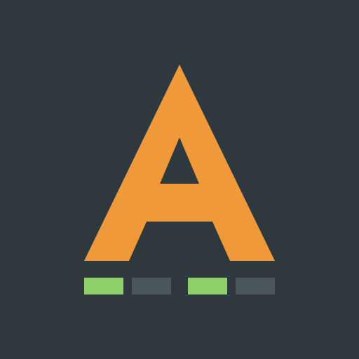
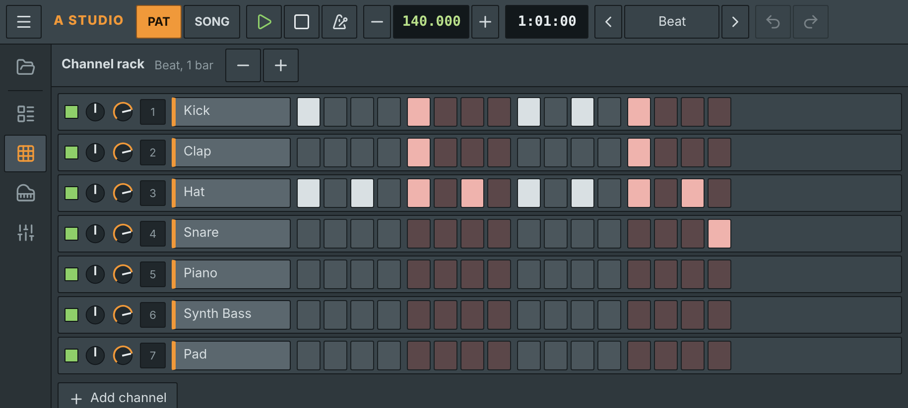
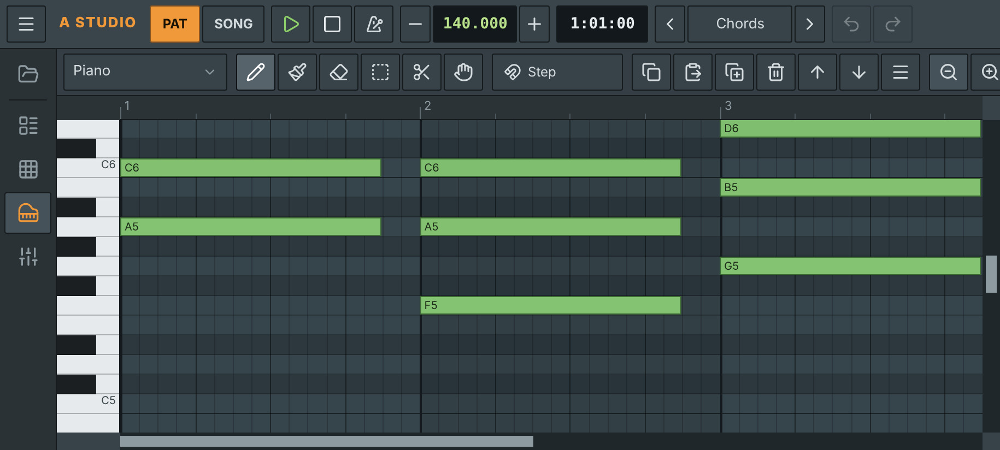
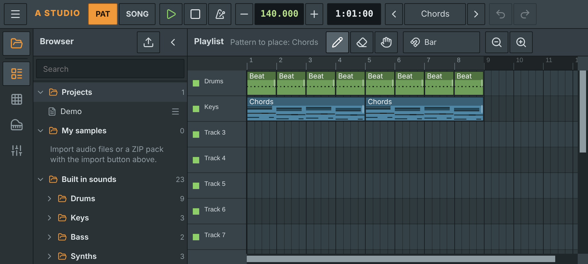
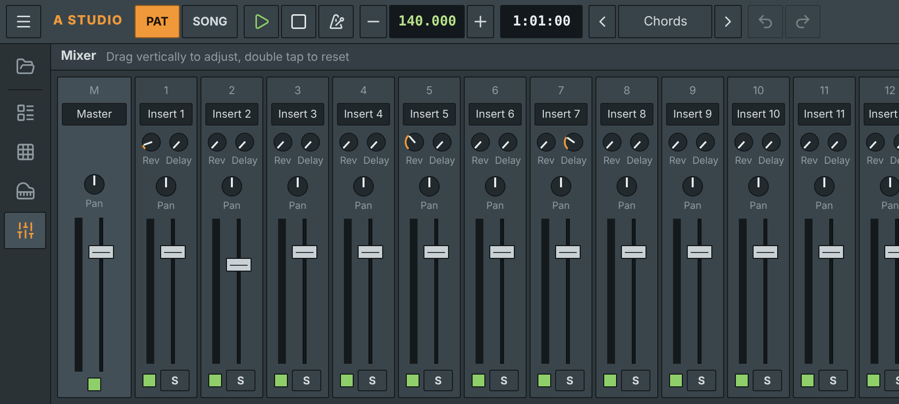
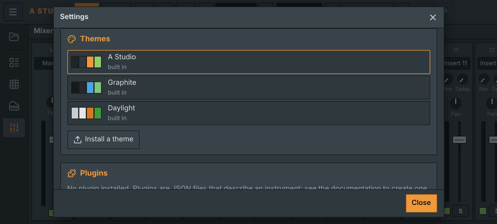

<div align="center">



# A Studio for Android

**A Studio is an open source music production studio for Android, built on the FL Studio workflow.**<br>
Channel rack, piano roll, playlist, mixer and a browser for your own samples, in your pocket.

<a href="https://github.com/kurodaki-dev/A-studio/releases/latest/download/A-Studio.apk"></a>
<a href="https://kurodaki-dev.github.io/A-studio/"></a>
<a href="https://kurodaki-dev.github.io/A-studio/doc/"></a>


[Screenshots](#screenshots) · [Features](#features) · [Piano roll](#piano-roll) · [Browser and samples](#browser-and-samples) · [Plugins and themes](#plugins-and-themes) · [Updates](#updates) · [Privacy](#privacy) · [Building](#building)

</div>

## Screenshots

<p align="center">
  
  
</p>
<p align="center">
  
  
</p>
<p align="center">
  
</p>
<p align="center"><sub>Channel rack, piano roll, playlist with the browser, mixer and settings, captured from the app in landscape.</sub></p>

## Features

- **Channel rack**: 16 steps per bar in FL Studio style groups, drag to fill or clear steps, per channel enable, pan, volume and mixer insert.
- **Piano roll**: draw, paint, delete, select, slice and pan tools, snap from 1/6 step to a bar, ghost notes, velocity lane, playable keyboard, copy, paste, duplicate, transpose and quantize.
- **Playlist**: PAT and SONG modes, 16 tracks, pattern clips and audio clips, stretch any clip from its right edge.
- **Mixer**: master and 16 inserts with fader, pan, reverb and delay sends, mute, solo, level meters and 4 effect plugin slots each.
- **Browser**: FL Studio style side panel with your projects, imported samples, plugins and 23 built in instruments.
- **Sounds**: drums (kick, snare, clap, hats, crash, tom, rimshot, cowbell), piano, electric piano, organ, synth and 808 bass, lead, pad, pluck, strings, guitar, flute, brass, marimba and bell, all synthesized in real time. Plus a Sampler for your own samples.
- **Projects**: autosave, saved projects, `.astudio` import and export, WAV export of a pattern or the whole song, undo and redo.
- **Settings**: English or French interface, themes, code plugins, update check.
- Scrollbars and two finger gestures for navigation, landscape full screen layout, keyboard shortcuts on tablets.

## Piano roll

The piano roll follows FL Studio: tap to place a note with the last used length, tap a note to reuse its length and velocity, drag to move, drag the right edge to resize, long press (or right click) to delete. Middle C is named `C5`, as in FL Studio. See the [documentation](https://kurodaki-dev.github.io/A-studio/doc/#piano-roll) for every tool.

## Browser and samples

Import audio files (WAV, MP3, OGG, FLAC, M4A, AIFF) or whole ZIP sample packs from the browser. Folders inside a pack are kept and everything stays on the device. Drag an item to the right (or long press it) and drop it:

- on a playlist track to make an audio clip,
- in the piano roll to create a Sampler channel and place a note,
- in the channel rack to create a Sampler channel.

## Plugins and themes

Install both from **Menu, Plugins and themes**.

- **Plugins** are JavaScript files. **Instruments** compute their own samples for every note; **effects** process a mixer insert (4 FX slots per insert). Controls are declared in the header: knobs, switches, choice lists and buttons. Write, test and export plugins on the phone with the built in editor. The code runs isolated in the audio thread (AudioWorklet), without access to the interface, storage, files or network; a crashing voice or effect is contained without taking the app down.
- **Themes** are JSON files that change the interface and editor colors, with hex values only.

The plugin API, the theme format and ready to install examples (Poly Synth, Stereo Delay, Bitcrusher, Supersaw, FM Bell, Noise Snare) are in the [documentation](https://kurodaki-dev.github.io/A-studio/doc/#plugins).

## Updates

Every push to `main` builds a signed APK and publishes a release `v1.0.<run number>`. At startup the app checks the latest release; when you tap Download it fetches the APK and opens the Android installer, which asks you to confirm. Tap Open at the end to restart on the new version. Your projects are kept. The startup check can be turned off in Settings.

## Privacy

A Studio collects no personal data: no account, no ads, no analytics. Projects, samples, plugins and themes stay on the device. The only connection asks GitHub for the latest release. See the [privacy policy](https://kurodaki-dev.github.io/A-studio/legal/privacy.html), [terms of use](https://kurodaki-dev.github.io/A-studio/legal/terms.html) and [cookie policy](https://kurodaki-dev.github.io/A-studio/legal/cookies.html). No cookie banner is needed: the app sets no cookies and only uses strictly necessary local storage.

## Building

Requirements: Node.js 22, JDK 21, Android SDK (platform 36).

```bash
npm install
npm run dev          # web version on http://localhost:5173
npm test             # unit tests
npm run build        # builds dist/
npx cap sync android # copies dist/ into the Android project
cd android && ./gradlew assembleDebug
```

### Releases

- `.github/workflows/android.yml` builds a signed APK on every push to `main` and publishes a release. Pull requests build a test APK only.
- `.github/workflows/pages.yml` publishes the web version, the documentation (`/doc`) and the legal pages on GitHub Pages.

Android only installs an update signed with the same key as the installed app. The key is never committed; the workflow reads it from two repository secrets:

| Secret | Content |
|---|---|
| `ANDROID_KEYSTORE` | The `.jks` file encoded in base64 (`base64 -w0 astudio.jks`) |
| `ANDROID_KEYSTORE_PASSWORD` | Password of the file and of the key (alias `astudio`) |

### Project structure

```
src/
  audio/        instrument catalog, synthesized instruments, engine (sequencer, mixer, export)
  ui/           channel rack, piano roll, playlist, mixer, browser, settings, controls
  locales/      translations (English is the source language)
  plugins.js    code plugins: header parsing and the AudioWorklet host
  themes.js     themes
  samples.js    sample storage (IndexedDB) and ZIP import
public/
  doc/          documentation site and plugin and theme examples
  legal/        privacy, terms and cookie pages (English, French in legal/fr)
android/        Capacitor project, including the in app updater
```

## Contributing

Bug reports and ideas are welcome: [open an issue](https://github.com/kurodaki-dev/A-studio/issues/new/choose). The app menu has **Report a bug** (the form opens with your version filled in) and **Request a feature**.

## License

MIT. Icons: [Lucide](https://lucide.dev), the icon set used by shadcn/ui (ISC license).

A Studio is an independent project, not affiliated with Image Line Software. FL Studio is a trademark of Image Line Software.
